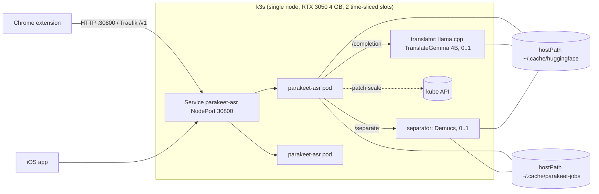
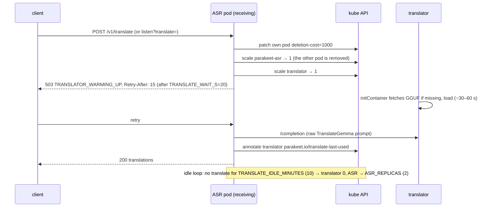
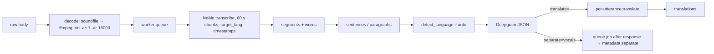

# Architecture

A deep dive for people forking Live Karaoke (repo `live-karaoke`; the backend and its k8s objects are still named `parakeet-asr`). For build steps, see [BUILD.md](BUILD.md). For the API surface, see [README.md](README.md#api).

## Components and Kubernetes objects



| object | file | notes |
|---|---|---|
| RuntimeClass `nvidia`, device-plugin DaemonSet + ConfigMap | `gpu-sharing.yaml` | time-slicing, `replicas: 2` |
| ServiceAccount/Role/RoleBinding `parakeet-asr` | `rbac.yaml` | get/patch on the deployments `parakeet-asr`, `translator`, `separator` and their scale; patch pods |
| Deployment + NodePort Service `parakeet-asr` | `asr.yaml` | 2 replicas, `nvidia.com/gpu: 1` each, `GPU_MEM_FRACTION=0.45`, `maxSurge 0` |
| Deployment + Service `translator` | `translator.yaml` | 0 replicas; llama.cpp `server-cuda` pinned by digest; `--n-gpu-layers 18`, ctx 2048, parallel 1 |
| Deployment + Service `separator` | `separator.yaml` | 0 replicas; same image, `uvicorn asr.separator_api:app` on :8001; **no** GPU slot |
| Ingress + Middleware `asr-retry` | `asr-ingress.yaml` | Traefik, 2 retries, TLS `${TLS_SECRET_NAME}` |
| Headlamp | `headlamp*.yaml` | optional cluster UI |

Service modules (`asr/`): `api.py` (FastAPI, middleware, errors, endpoints), `worker.py` (GPU worker queue),
`engine.py` (NeMo model, 60 s chunks, word timestamps), `audio.py` (soundfile, then ffmpeg fallback to 16 kHz mono),
`sentences.py`, `translate.py` (prompting, language detection, echo retry, `TranslatorClient`, `ModeController`),
`jobs.py` (job store, runner), `separate.py` (chunked Demucs), `separator_api.py` (separator pod API), `schemas.py`, `wer.py`.

## GPU memory budget

| resident | VRAM |
|---|---|
| ASR pod (bf16 0.6B + activations; capped by `GPU_MEM_FRACTION=0.45`) | ~1.66–1.67 GB |
| translator, 18/34 layers on GPU (the rest on CPU) | ~1.75 GB |
| Demucs (when ≥ 900 MiB free) | ~0.8 GB (nvidia-smi Δ) |

The GPU holds either **2 ASR pods** or **1 ASR pod + translator**, never all three. Time-slicing gives no memory isolation, so
each ASR process caps itself with `torch.cuda.set_per_process_memory_fraction`. A CUDA OOM becomes a retryable `503 GPU_OUT_OF_MEMORY`.

## Translate-mode scaling (`ModeController`, `asr/translate.py`)


Mode switching works only in-cluster: it needs the service-account token and `TRANSLATE_MODE_SWITCH=1`. Otherwise `/v1/info` reports
`mode: unmanaged`. The separator uses the same controller (`ensure_separator`, idle `SEPARATOR_IDLE_MINUTES` = 5).

## Request flows

### Listen

A full queue returns `503 SERVER_BUSY`. The `x-served-by` header carries the pod name.

### Translate
For each sentence, `build_prompt` produces a raw chat-template prompt (`<start_of_turn>user\nYou are a professional <Src> (<src>) to <Tgt> (<tgt>) translator. …<end_of_turn>\n<start_of_turn>model\n`,
stop `<end_of_turn>`), so llama.cpp needs no `--jinja`. If the source is unknown, the prompt uses a neutral "translator into X" wording. `clean_output` strips quotes wrapped around the whole answer.

### Separate (job)
```mermaid
sequenceDiagram
  participant C as client
  participant A as ASR pod
  participant S as separator
  participant FS as /jobs hostPath
  C->>A: POST /v1/separate (≤200 MB)
  A->>FS: write input + job.json (status queued)
  A-->>C: 202 job_id
  A->>A: ensure_separator (scale 0→1, wait ≤ SEPARATOR_WAIT_S)
  A->>S: separate(job dir)
  S->>S: Demucs chunks: CUDA if ≥900 MiB free else CPU; OOM → CPU retry
  S->>FS: vocals.wav, instrumental.wav
  A->>A: ASR on the vocals stem (status transcribing)
  A->>FS: mux: -c:v copy + instrumental (video) or mp3 (status muxing → done)
  C->>A: GET /v1/jobs/id (poll every 2 s), then /download (Range)
```
Chunking: 30 s chunks with a 1 s linear crossfade, and Demucs `segment` 7.8 s inside each chunk, so memory stays bounded for any song length.
Measured on a 160 s song: `htdemucs_ft` on cuda 50.6 s, `htdemucs` on cuda 14 s, `htdemucs` on cpu 50.7 s; max RSS 2.6 GiB.

## Sentence splitting (`asr/sentences.py`)
- Break after terminal punctuation `. ! ? … 。 ！ ？` (optionally followed by closing quotes or brackets).
- Break at a pause > **3 s**, but only when the sentence already has ≥ **8** words (short mid-clause pauses stay together).
- Force a break in run-on text at **40** words, at the last comma/`;:—–` when it is past 10 words in, otherwise at 40.
- A sentence's time span runs from its first word's start to its last word's end. Without word timings, text is split on punctuation and times are interpolated by character count.

## Language detection and echo retry
- `detect_language` uses the script first (Cyrillic, then uk/bg/ru by distinctive letters; Greek, Arabic, Devanagari, Thai, kana, Hangul, Han), then stop-word sets for Latin-script languages. If unsure (no hits, or a tie with ≥ 4 words), it returns `None`.
  The result is reported as `detected_language` with `language=auto` and used as the translation source.
- `looks_untranslated`: the output counts as an echo if it is > 80 % similar to the input (difflib, input > 12 chars), or if < 80 % of its letters are in the target's script.
  An echo is retried once with a **strict** prompt (one extra instruction: translate every word, never copy the source), then **clause by clause** (`split_clauses`, ≤ 14 words).

## Word timestamps
NeMo `transcribe(..., timestamps=True)` gives `hyp.timestamp["word"]` with start/end in seconds. Each word is shifted by its chunk offset (`i * 60 s`) and rounded to ms.
`ASR_WORD_TIMESTAMPS=0` disables them, and clients then fall back to utterance highlighting. The model is prompt-conditioned
(`supports_language`), so `language` is passed as `target_lang`.

## Job lifecycle and cleanup (`asr/jobs.py`)
`queued → separating → transcribing → muxing → done`, or `failed` / `cancelled`. Each job is a directory under `JOBS_DIR`, with
`job.json` written by whichever pod runs it (the jobs volume is shared, so any ASR pod can answer `GET /v1/jobs/<id>`).
- `expires_at` = creation + `JOB_TTL_MINUTES` (60), reset to completion + TTL when a job finishes. `cleanup_loop` (every 300 s) deletes expired job dirs and orphans.
- A running job that has not heartbeated for `JOB_STALE_S` (600) is marked `failed / JOB_LOST` (e.g. its pod died).
- `DELETE` cancels and removes the job immediately. Admission control: `JOBS_MAX_ACTIVE` (3) and `JOBS_MIN_FREE_GB` (5).

## Extension architecture (`extension/`)
- **MV3**: `background.ts` (service worker), `app.ts` (popup/side-panel UI), `shared.ts` (state, IndexedDB, pure helpers, unit-tested by `scripts/test.mjs`).
- **The background worker owns all network work**, because a popup closes when it loses focus. The dropped file is stored in
  **IndexedDB**, and job state is kept in `chrome.storage.session`. The UI just renders state, so reopening restores the transcript, translation, player and karaoke.
- **Pipeline:** `/v1/listen?paragraphs=true` → (if Translate is on) `/v1/translate` in small batches, with 503 Retry-After retried
  ("Translator warming up") → (if Remove vocals is on) `/v1/separate`, then poll `/v1/jobs` every 2 s.
- **Layout rules:** the popup is at most 800×600 (Chrome's limit) and one pane is 400 px wide unless a translation is shown. Transcript and translation sit side by side in the popup or a wide side panel and stack in a narrow one.
  Settings (gear) holds the server, language, translate, remove vocals and version info.
- **Karaoke swap:** when a job is done, the player source is replaced by `/v1/jobs/<id>/download` at the same `currentTime`
  and play state (the download supports Range, so it can seek). Unticking restores the original from IndexedDB, and a running job is `DELETE`d.
- **Highlight lead:** `wordAt(words, t, lead, pause=0.3)` with `KARAOKE_LEAD_S = 0.25` in karaoke mode (0 otherwise). The current
  line is marked and centred, and the translated sentence covering `t` is highlighted.

## iOS app architecture (`ios/ParakeetKaraoke/Sources`)
- `Models.swift`: SwiftData `@Model KaraokeBundle` (title, original/karaoke file names, isVideo, language, detectedLanguage,
  status, progress, **jobId**, sourceURL, thumbnail, JSON blobs for original words, vocal words and translations keyed `mode|target`).
  Files live in Application Support, one directory per bundle id. It also holds the line building and the `wordAt`/`lastStarted` helpers (same 0.25 s lead as the extension).
- `Processor.swift`: one task per bundle: import (file copy or URL download) → `listen` → `separate` → poll the job → download →
  translate on demand. Status and progress are persisted after each step.
- **Job resume:** on launch, `LibraryView.resume()` restarts every bundle that is not `ready`/`error`. A saved `jobId` is polled again,
  not re-uploaded (until the server TTL expires).
- `API.swift`: URLSession client, with automatic 503 + Retry-After waits (`onWait` status text) and Deepgram-style error messages.
- `PlayerView.swift`: AVPlayer + AVPlayerLayer, karaoke/original swap keeping position, timed lyrics and translation.
- **Deep links** (`parakeetkaraoke://`): `import?url=&title=&lang=`, `open?index=&mode=karaoke|original`, `settings`, `new`.
  Opening a file URL (Files/share) imports it.
- `Info.plist`: background audio, file sharing, Local Network usage description, ATS allows HTTP.

### Optional add-ons (`PremiumHooks.swift`)
`PremiumFeatures` is the only coupling to optional add-on features: extra SwiftData model types, a
lyrics provider (a control that may hand the player replacement lyric lines with timed words), a
recorder entry point shown on the karaoke track, extra Settings rows, a recordings list, and a UI-test
seeding hook. The public build uses `NoPremium` (all no-ops). A private build compiles
`PremiumBridge.swift` (`#if PREMIUM`) against a separately licensed package; see BUILD.md (`LK_PREMIUM`).
Translations of replacement lines are cached under a `v`-prefixed key (`vk|en`) so they never mix with
transcript translations. Files the app writes to Documents are visible in the Files app
(`UIFileSharingEnabled`, `LSSupportsOpeningDocumentsInPlace`).

## Configuration (env vars)

| var | default | where |
|---|---|---|
| `ASR_MODEL` | `nvidia/nemotron-labs-unified-asr-0.6b` | engine |
| `ASR_DEVICE` | `cuda` | engine (`cpu` works, fp32, slow) |
| `ASR_WORD_TIMESTAMPS` | `1` | engine |
| `GPU_MEM_FRACTION` | `0` (unset); `0.45` in k8s | engine |
| `TRANSLATOR_URL` | `http://translator:8080` | translate |
| `TRANSLATE_WAIT_S` | `20` | api |
| `TRANSLATE_IDLE_MINUTES` / `ASR_REPLICAS` | `10` / `2` | ModeController |
| `ASR_DEPLOYMENT` / `TRANSLATOR_DEPLOYMENT` / `SEPARATOR_DEPLOYMENT` | `parakeet-asr` / `translator` / `separator` | ModeController |
| `TRANSLATE_MODE_SWITCH` | `1` | ModeController |
| `SEPARATOR_IDLE_MINUTES` | `5` | ModeController |
| `JOBS_DIR`, `JOB_TTL_MINUTES`, `JOB_STALE_S`, `JOBS_MAX_ACTIVE`, `JOBS_MIN_FREE_GB` | `/jobs`, 60, 600, 3, 5 | jobs |
| `SEPARATOR_URL`, `SEPARATOR_WAIT_S` | `http://separator:8001`, 600 | jobs |
| `SEPARATOR_MODEL` / `SEPARATOR_CPU_MODEL` | `htdemucs_ft` / `htdemucs` | separator |
| `SEPARATOR_DEVICE`, `SEPARATOR_MIN_FREE_VRAM_MB` | `auto`, 900 | separator |
| `SEPARATOR_CHUNK_S`, `SEPARATOR_OVERLAP_S`, `SEPARATOR_SEGMENT_S` | 30, 1, 7.8 | separator |
| `TORCH_HOME`, `HF_HOME` | `/models/torch`, `/models` | image/manifests |
| `N_GPU_LAYERS` | 18 | translator container |
| `GIT_SHA` | build arg | `/v1/info` |

## Testing
- `pytest -m "not accuracy"`: sentences, translate (prompt, detection, echo retry, mode logic), separate (chunking/crossfade, job
  lifecycle/TTL, cancellation, naming, mux packet equality, job API with fakes), info, audio decoding, WER.
- `pytest -m accuracy`: live server + `testdata/` audio (FLEURS ru WER, ru→en translation).
- Extension: `npm test` (helpers), `scripts/e2e.mjs` (live), `scripts/sep_e2e.mjs` + `scripts/sep_mock.py` (karaoke flows against a mock server).
- iOS: manual testing via deep links on simulator and device.

## Extension points
- **Another ASR model:** set `ASR_MODEL` to any NeMo `ASRModel`. Language prompting applies only to prompt models (`supports_language`).
- **Another translator:** anything that serves llama.cpp's `/completion` + `/health` at `TRANSLATOR_URL`. Change `build_prompt` for a different chat template.
- **Another separator:** implement the `separator_api` contract (`GET /healthz`, `POST /separate` (202) on a job directory into `vocals.wav`/`instrumental.wav`).
- **Bigger GPU:** raise `ASR_REPLICAS`/time-slice replicas, or give the translator all layers (`N_GPU_LAYERS=99`). You can also skip the mode switch entirely
  (`TRANSLATE_MODE_SWITCH=0` and run the translator permanently).
- **New clients:** the extension (`shared.ts`) and the iOS `API.swift` are compact references for the 503/Retry-After, polling and highlight-lead logic.

## Porting (ARM / non-CUDA)
Target example: Steam Frame (ARM64, no CUDA).
- **ASR:** the CUDA torch + NeMo stack is x86/CUDA-specific. Options: NeMo on CPU (`ASR_DEVICE=cpu`, aarch64 torch wheels, slow), or
  export to ONNX and run with **sherpa-onnx** (has ARM builds and NeMo transducer/CTC support). Keep `engine.Segment/Word` as the interface,
  so `api.py`, `sentences.py` and the clients stay unchanged.
- **Translator:** llama.cpp builds on ARM; use the **Vulkan** backend (or CPU/NEON) instead of `server-cuda`. Replace the image digest and drop
  `runtimeClassName: nvidia` and `nvidia.com/gpu`. The GGUF is unchanged.
- **Demucs:** already runs on CPU (`SEPARATOR_DEVICE=cpu`, `htdemucs`). Expect about real-time to 3× slower on ARM cores. Reduce `OMP_NUM_THREADS` and memory limits to fit.
- **k8s:** remove `gpu-sharing.yaml` and the GPU resource limits. On a single device without GPU slots, the ModeController's ASR↔translator swap is unnecessary
  (set `TRANSLATE_MODE_SWITCH=0`, and run the translator with replicas 1 if memory allows). Build the image with `docker buildx --platform linux/arm64`
  and a CPU torch index instead of `cu128`.
- **Paths:** the hostPaths and LAN IP are hard-coded (see README limitations).
